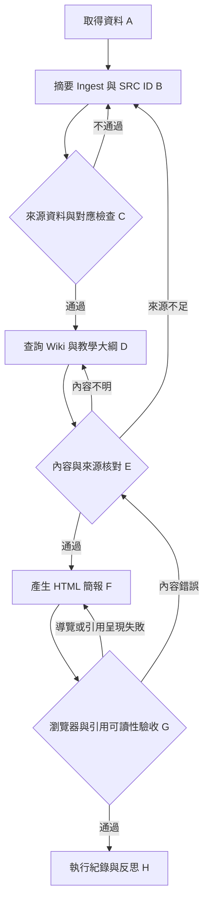

# 第十週作業：LLM Wiki → 教學 HTML 簡報 Workflow / Graph

## 1. 任務與範圍

主題：Robotic Arm Wiki（機械手臂技術知識庫）

輸入：六份外部教材／技術規範之摘要型 ingest 資料（`sources/ingest-records.json`）、現有六篇 Wiki 文章。

輸出：八頁教學簡報 `slides.html`、可追溯的來源頁 `sources/index.html`、檢查及反思紀錄。

**實作範圍說明：** 使用人工＋LLM 協作執行各節點，以 JSON 保存摘要型知識庫，不是已完成全自動 Agent、向量資料庫或自動排程。以下 graph 是此次實際工作程序的結構化描述；每次檢查後依結果手動返回節點修正。

## 2. 節點與檢查條件

| 節點 | 工作 | 輸入／輸出 | 檢查與失敗處理 |
|---|---|---|---|
| A：取得資料 | 收集 Modern Robotics、CTMS、ROS 規範 | 來源連結與技術重點 | 來源不明 → 重新取得 |
| B：資料整理與 Ingest | 摘要、建立 SRC ID、對應 Wiki | `sources/ingest-records.json` | 缺欄位／重複 ID → 重整 |
| C：來源驗證 | 檢查 6 筆、文章路徑、方法差異 | `sources/source-map.md` | 缺少對應 → 返回 B |
| D：教學大綱 | 依 Wiki 整理初心者可讀的教學順序 | 8 頁章節規劃 | 難度或順序不合理 → 重整 |
| E：內容驗證 | 查核每頁與 Wiki、SRC 對應；區分公式方法 | 經審查的簡報文案 | 誤把不同方法視為同一方法 → 返回 D 或 B |
| F：HTML 生成 | `slides.html`、`css/slides.css`、`js/slides.js` | 互動式簡報 | 排版或功能問題 → 修改 F |
| G：使用者驗收 | 開啟網站、頁面切換、連結、手機版 | 測試紀錄 | 來源難閱讀 → 回到 F，改引用呈現形式 |
| H：紀錄反思 | 保存錯誤、修正結果及新增檢查 | `execution-log.md` | 未驗證的測項保留未驗證狀態 |

## 3. Graph（Mermaid）

## 4. 實際發生的重複迴圈

第一次生成的引用連結導向原始 JSON（`sources/ingest-records.json`）。使用者實測後回報點擊 SRC 編號只看到 JSON 原文。於是回到節點 F，**新增** `sources/index.html` 人類可讀來源頁、**局部修改** `slides.html` 中的引用連結。沒有改動 Wiki 六篇文章、`js/main.js`、原本控制簡報切換的 `js/slides.js`。

使用者再次測試，回報「可以了」。這是此次可確認的使用者驗收結果，不代表已自動測試所有外部教材連結。

## 5. 為何這樣設計

- 將來源完整性檢查安排在生成之前，避免先生成再補來源。
- 將「有 SRC ID」與「讀者能理解點擊結果」分開檢查，避免程式正確但教學體驗不佳。
- 失敗時只回到相關節點，不重建整個網站，遵守最小必要修改原則。
- 用具體的 Wiki 頁面與來源 ID 建立可追溯路徑。

## 6. 範圍限制

六份資料是「摘要型 ingest」，不等於全文下載、向量化或自動 RAG。相關內容的技術正確性，尤其 FK/IK 教學採用的不同表述，仍須依 `sources/source-map.md` 分別核對。對外部網站的可連線性與手機實測，應區分程式檢查與使用者實測。
